smb-share-manager
=================

A small Docker container with a web UI for one job: sharing folders over SMB (Samba) and
managing the SMB users who can reach them. It is the file browser, Shares and Users part
of nas-dashboard, without the dashboard and apps, on a hardened backend, with images
published automatically so the server only ever pulls.

<picture>
  <source media="(prefers-color-scheme: light)" srcset="docs/screenshots/files-light.png">
  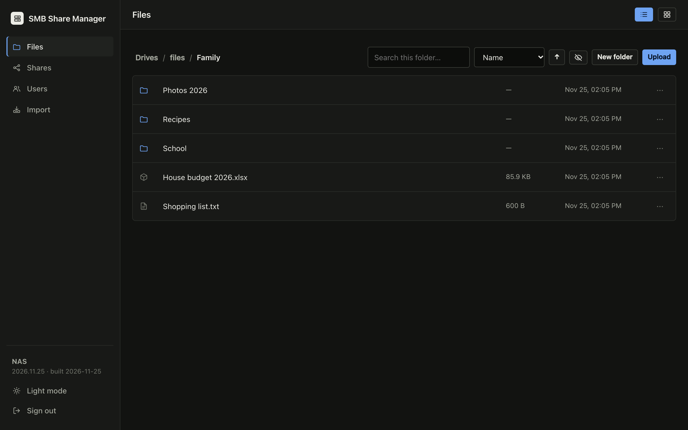
</picture>

What it does:

- admin login (one admin)
- Files: browse the folders you mount, as drives; list or grid view, sort, search this
  folder, new folder, rename, copy/cut/paste, delete, upload with progress, download.
  Files are always downloaded, never opened in the page.
- right-click a folder and choose "Share via SMB": pick who gets read-only or read & write
  access
- Shares: see every share and who can use it, edit, unshare (connected clients are
  disconnected), view the live Samba configuration, check that Samba agrees with the UI,
  fix a share folder's permissions on unix filesystems (only after you tick to confirm)
- Users: SMB accounts with a display name; create, change password, remove
- Import: one-time import of users (with their old passwords) and shares from CasaOS or
  another Samba server
- a warning when a folder is on exFAT/FAT/NTFS, where access is enforced by Samba at share
  level only
- light and dark mode, works on a phone (long-press opens the menu)
- optional, off by default: WebDAV access from outside (iOS Files, Finder, rclone) and a
  files portal in the browser behind Pangolin single sign-on, both limited to the shares
  and users you choose

It deliberately does nothing else: no system stats, no app launcher, no terminal, no file
preview, no telemetry and no update checks. It makes no network calls of its own.

How it works:

- The UI is a React app (from nas-dashboard) built into the image. It talks to a JSON API
  that needs a login session and a CSRF token for every change.
- smbd runs as root inside the container, because it has to switch to each SMB user.
- The web UI runs as your user (PUID/PGID, default 1000).
- Everything that needs root goes through a small helper. It is reachable only over a
  private unix socket and offers a fixed list of operations, not a command runner.
- All state lives in ./data next to docker-compose.yml.

SECURITY.md describes the threat model and docs/UPDATING.md describes automatic updates.


Screenshots
-----------

Demo data, captured from the real app in Chromium. GitHub shows the light or dark version
to match your theme.
Regenerate them after a UI change with `uv run python scripts/screenshots.py` (needs
`npm run build` and `uv run playwright install chromium-headless-shell` first).

**Files.** Your mounted folders appear as drives. Browse, search, upload, download, rename,
copy and move; shared folders carry a badge.

<picture>
  <source media="(prefers-color-scheme: light)" srcset="docs/screenshots/files-light.png">
  
</picture>

<picture>
  <source media="(prefers-color-scheme: light)" srcset="docs/screenshots/drives-light.png">
  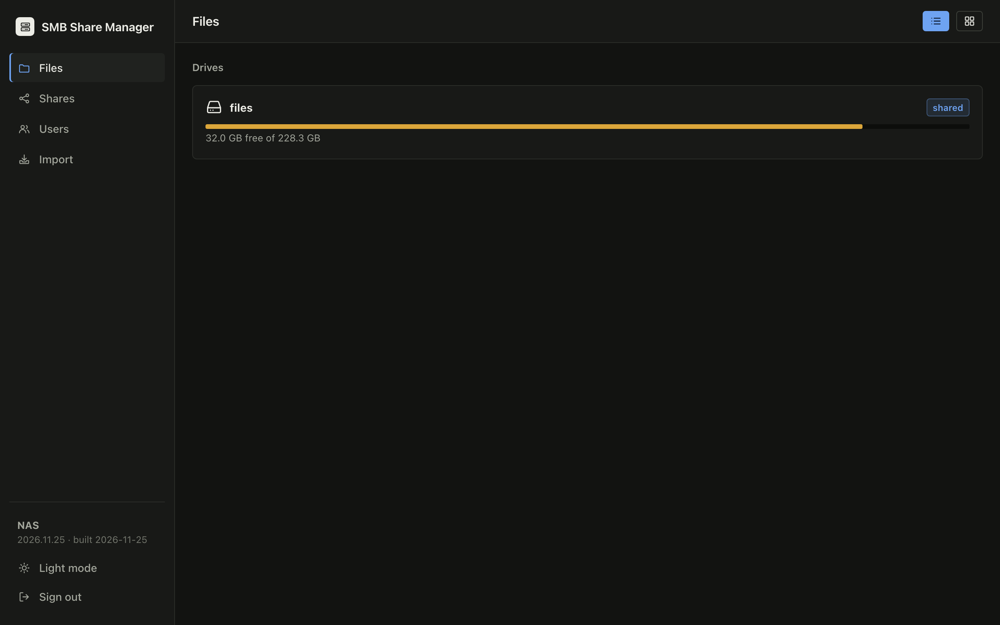
</picture>

**Share a folder in two clicks.** Right-click it, choose Share via SMB, tick who gets read
or read & write.

<picture>
  <source media="(prefers-color-scheme: light)" srcset="docs/screenshots/context-menu-light.png">
  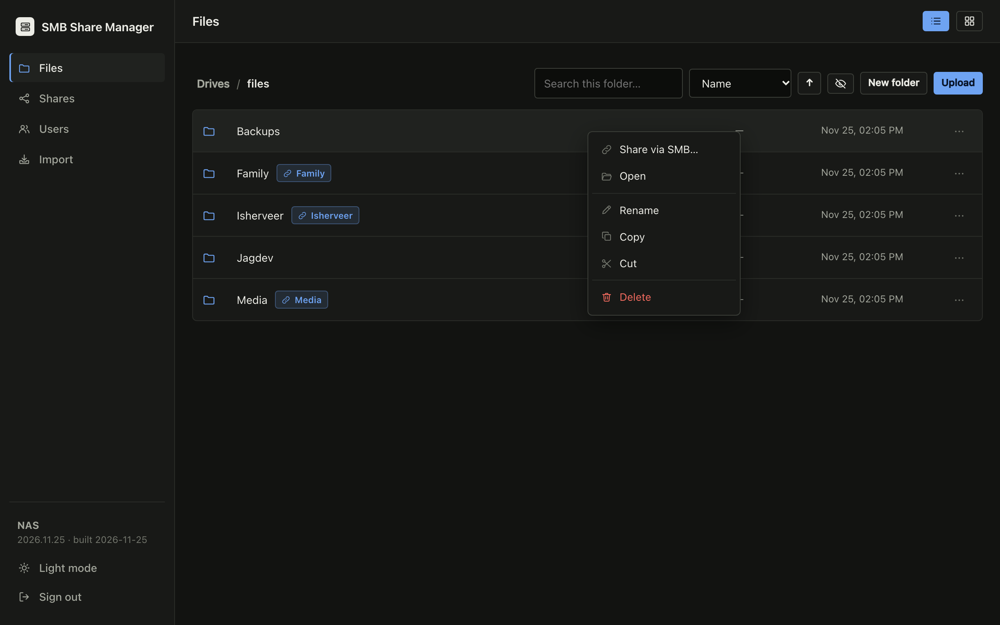
</picture>

<picture>
  <source media="(prefers-color-scheme: light)" srcset="docs/screenshots/share-dialog-light.png">
  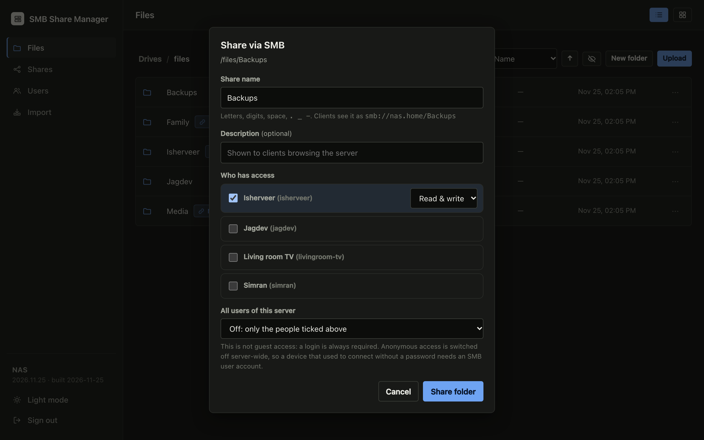
</picture>

**Shares.** Every share, its folder, who can use it and the live state of Samba.

<picture>
  <source media="(prefers-color-scheme: light)" srcset="docs/screenshots/shares-light.png">
  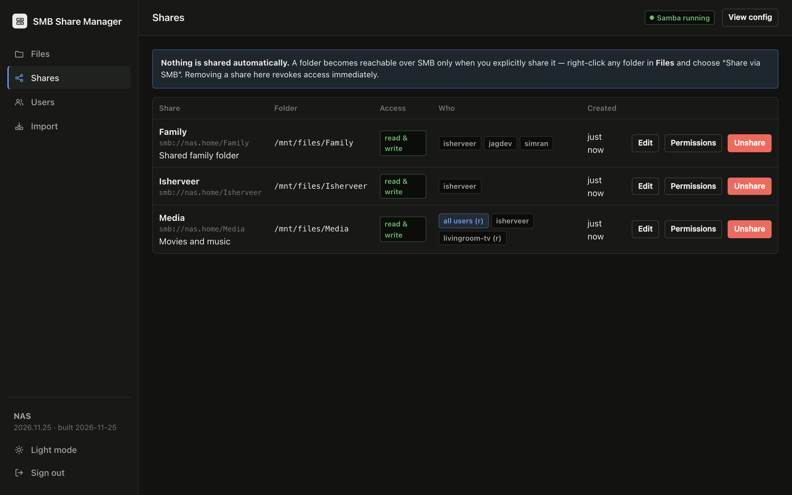
</picture>

**Users.** SMB accounts, their shares, and a `remote` badge for users allowed in over
WebDAV.

<picture>
  <source media="(prefers-color-scheme: light)" srcset="docs/screenshots/users-light.png">
  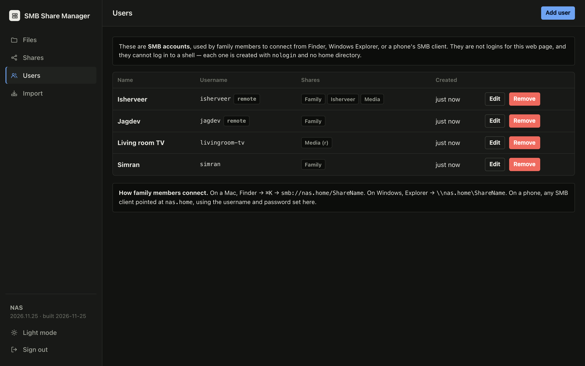
</picture>

**Remote access is per user and off by default.** It's a tick in the user's dialog, with a
reminder to use a long password (see "WebDAV access from outside").

<picture>
  <source media="(prefers-color-scheme: light)" srcset="docs/screenshots/remote-access-light.png">
  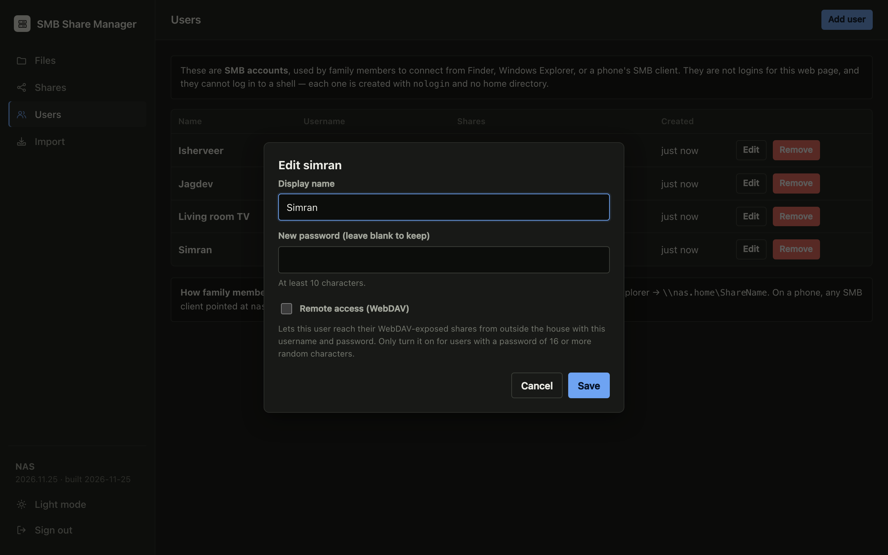
</picture>

**Sign-in.** One admin password; the UI is meant for your LAN or Tailscale only.

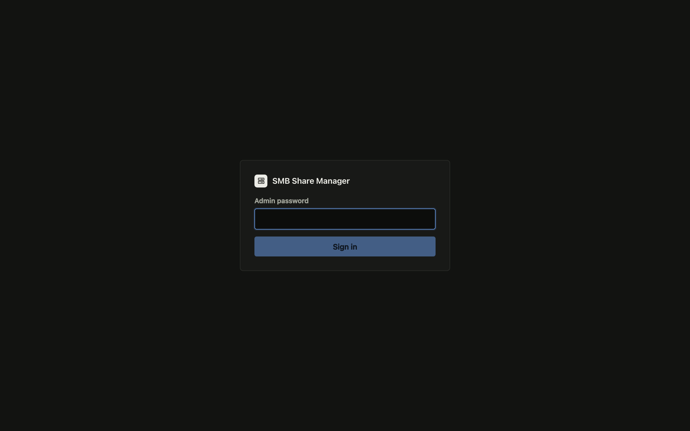


Requirements
------------

- Linux with Docker and Docker Compose
- The folders you want to share, on the host (e.g. /mnt/files)
- Nothing else may listen on ports 445/139 on the host (stop the host Samba first, or use
  other ports while testing; see "Trying it beside CasaOS")


Install
-------

Pick a folder for the compose project, for example ~/docker/smb-share-manager:

```bash
mkdir -p ~/docker/smb-share-manager && cd ~/docker/smb-share-manager
```

```bash
curl -fsSLO https://raw.githubusercontent.com/codemastervy/smb-share-manager/main/docker-compose.yml
```

```bash
curl -fsSL -o .env https://raw.githubusercontent.com/codemastervy/smb-share-manager/main/.env.example
```

```bash
mkdir -p scripts && curl -fsSL -o scripts/smoke-test.sh https://raw.githubusercontent.com/codemastervy/smb-share-manager/main/scripts/smoke-test.sh && chmod +x scripts/smoke-test.sh
```

Edit .env. The only setting you must change is ADMIN_PASSWORD (at least 10 characters).
Keep the file private:

```bash
chmod 600 .env
```

Check the volume list in docker-compose.yml. By default only /mnt/files is mounted, at
the same path inside the container, and VOLUMES=/mnt/files in .env must match. Never
mount /, /proc, /sys or /mnt/timenest (the Time Machine disk): what isn't mounted can't be
browsed or shared.


exFAT disk permissions (do this once)
-------------------------------------

exFAT has no unix permissions. Ownership and access bits come from the mount options. With
the current root:root 755 mount, only root can write, so neither the SMB users nor the
folder browser could create files.

Mount /mnt/files so that your user owns it and the container's SMB group (gid 3000,
"smbusers") can write. In /etc/fstab, change the options of the /mnt/files line to:

```
uid=1000,gid=3000,umask=0002
```

A full line looks like this (keep your own UUID and any other options such as nofail):

```
UUID=XXXX-XXXX  /mnt/files  exfat  uid=1000,gid=3000,umask=0002,nofail  0  0
```

This replaces the older uid=1000,gid=1000,umask=000 line and still works for everything
else that uses the disk. It takes effect after a reboot (or an unmount and mount when
nothing is using the disk).

What this means: on exFAT, Samba enforces who may read or write at share level, by the
share's member list. Inside a share there are no per-file permissions. The UI warns about
this when you share an exFAT folder.

On ext4 or other unix filesystems, a share folder must belong to group 3000 and be
group-writable. The share's edit page shows the exact change and applies it only when you
tick "fix permissions". It changes the folder itself, never anything inside it.


First run
---------

```bash
docker compose up -d
```

```bash
docker compose ps
```

Wait until the status shows "healthy", then open http://<server>:8095 and log in with
ADMIN_PASSWORD. If you reach the UI by host name (for example nuc or nuc.tailnet.ts.net),
add that name to ALLOWED_HOSTS in .env. IP addresses always work.

Then:

1. Users: Add user.
2. Files: open the "files" drive, right-click a folder and choose "Share via SMB".
3. Tick the user, choose read-only or read & write, and click "Share folder".
4. On a Mac: Finder, Go, Connect to Server, smb://<server>, then log in as that user.
5. To stop sharing: Shares, "Unshare". Clients are disconnected and the folder is not
   touched.

If the container keeps restarting, check the log:

```bash
docker compose logs --tail 50
```

It refuses to start without ADMIN_PASSWORD or ADMIN_PASSWORD_HASH.


Trying it beside CasaOS
-----------------------

You can run it while CasaOS's Samba still owns ports 445/139. In .env set:

```
SMB_PORT_445=1445
SMB_PORT_139=1139
```

```bash
docker compose up -d
```

Create a test user and share, then connect with smb://<server>:1445 from a Mac. From
Linux, use smbclient -p 1445.


Migrating from CasaOS
---------------------

The order matters. The old Samba is stopped before its password database is copied, so the
copy is consistent. The import copy contains password hashes, so it is root-only and
removed afterwards.

1. Back up the old Samba configuration and state:

```bash
sudo tar -czf ~/samba-backup-$(date +%Y%m%d).tar.gz /etc/samba /var/lib/samba
```

2. Stop the host Samba (CasaOS uses the system smbd/nmbd):

```bash
sudo systemctl stop smbd nmbd
```

3. Copy the old configuration and passdb into ./import, readable by root only:

```bash
sudo mkdir -p import && sudo cp -a /etc/samba import/etc-samba && sudo cp -a /var/lib/samba import/var-lib-samba && sudo chown -R root:root import && sudo chmod 700 import
```

4. In docker-compose.yml, uncomment this line:

```
      - ./import:/import:ro
```

5. In .env, set the real ports (or remove the two lines):

```
SMB_PORT_445=445
SMB_PORT_139=139
```

6. Start (or recreate) the container:

```bash
docker compose up -d
```

7. Open the Import page in the sidebar:
   - Import each user first. Users keep their old SMB password, and the hash never
     leaves the container's root helper.
   - Then import each share. Check the folder path: CasaOS paths such as /DATA/... must
     be changed to the path here, e.g. /mnt/files/....
   - Shares that were anonymous (guest) are flagged. They now need an SMB login, because
     anonymous access is switched off. Tick the box to confirm, and give those devices a
     user account.

8. Remove the import data again. Comment out the ./import line in docker-compose.yml, then:

```bash
sudo rm -rf import
```

```bash
docker compose up -d
```

The UI shows a warning banner for as long as /import is still mounted.

9. Check that everything works:

```bash
SMB_SHARE=Files SMB_USER=isherveer ./scripts/smoke-test.sh
```

10. Stop the host Samba from coming back at boot:

```bash
sudo systemctl disable smbd nmbd
```

To roll back: run docker compose down, then sudo systemctl start smbd nmbd. Your old
configuration was never modified.


Checking from a Mac (do this once after go-live)
------------------------------------------------

CI can't drive Finder, so check these by hand:

1. Finder, Go, Connect to Server, smb://<server>: the login prompt appears. Choosing
   "Guest" must fail.
2. Log in as a member: the share opens. Copy a file in (read/write members) or confirm
   that copying fails (read-only members).
3. Log in as a non-member: the share is not accessible.
4. Remove the share in the web UI: Finder's window for it disconnects or reports an
   error.
5. Optional, to check that signing or encryption is active on the connection: run this in
   Terminal while connected and look at SIGNING_ON / ENCRYPTION:

```bash
smbutil statshares -a
```


Configuration (.env)
--------------------

| Variable | Default | Meaning |
|---|---|---|
| ADMIN_PASSWORD |  | Admin password (min. 10 characters). Required unless ADMIN_PASSWORD_HASH is set. |
| ADMIN_PASSWORD_HASH |  | argon2id hash instead of a plain password (write $ as $$ in .env). |
| VOLUMES | /mnt/files | Comma-separated folders that can be browsed and shared (container paths; mount them at the same path). |
| WEB_PORT | 8095 | Host port of the web UI. |
| BIND_ADDR | 0.0.0.0 | Host address the web UI listens on (e.g. a LAN or Tailscale IP). |
| ALLOWED_HOSTS |  | Extra host names accepted in the Host header (IPs and localhost are always accepted). |
| TRUSTED_PROXIES |  | Reverse proxies whose X-Forwarded-For/-Proto are believed. Default: none. |
| COOKIE_SECURE | auto | auto, true or false. Use true behind an HTTPS proxy that is not in TRUSTED_PROXIES. |
| MAX_UPLOAD_MB | 4096 | Upload size limit per file. |
| SMB_PORT_445 / SMB_PORT_139 | 445 / 139 | Host ports for SMB. |
| SMB_BIND_ADDR | 0.0.0.0 | Host address SMB listens on. |
| SMB_SERVER_NAME | NAS | Server name shown to clients (max 15 characters). |
| SMB_HOSTS_ALLOW |  | Optional allow-list of client networks, e.g. 192.168.68.0/24,100.64.0.0/10. |
| ENABLE_NMBD | false | NetBIOS name service (not needed by macOS or Windows 10+). |
| PUID / PGID | 1000 / 1000 | User and group the web UI runs as. |

The SMB group "smbusers" is fixed at gid 3000, and SMB users get uids from 3000 up. These
accounts only exist inside the container and can't log in to anything except Samba.


Ports, networking and why not host networking
---------------------------------------------

The container uses normal published ports, not host networking:

- It stays out of the host's network namespace and needs no NET_ADMIN or NET_RAW.
- Docker keeps the real client address for LAN and Tailscale clients, so the login
  throttle and SMB_HOSTS_ALLOW see real peers.

SMB needs only TCP 445; 139 is kept for old clients. The cost is no NetBIOS broadcast
browsing, which macOS and current Windows don't use: connect with smb://<server>.


WebDAV access from outside
--------------------------

**Quick setup (WebDAV and the files portal together).** On the server, in the folder with
docker-compose.yml and .env, after updating to this release:

```bash
curl -fsSLO https://raw.githubusercontent.com/codemastervy/smb-share-manager/main/scripts/remote-access.sh
curl -fsSLO https://raw.githubusercontent.com/codemastervy/smb-share-manager/main/scripts/portal-spoof-test.sh
chmod +x remote-access.sh portal-spoof-test.sh
./remote-access.sh setup
```

It does the steps below for you:
- backs up .env;
- lists your shares and asks which to offer;
- finds their folders on the host;
- picks up Traefik's network;
- creates the proxy secret;
- turns on Remote access and sets the sign-in e-mail for the people you choose;
- writes compose.remote.yml (your docker-compose.yml is not touched; COMPOSE_FILE in .env
  points at both);
- starts both services and runs the smoke test;
- prints the exact settings to enter in Pangolin.

After setting up Pangolin and signing in once at the portal, `./remote-access.sh verify
https://files.example.org` runs the spoof test and switches the portal on.
`./remote-access.sh doctor` explains refused requests. Running setup again is safe.

The manual steps follow, for reference.

An optional second service in the same compose file (same image, container smb-dav, port
8094) lets SMB users reach their shares from outside the house over WebDAV: iOS Files,
macOS Finder, Windows, rclone, Cryptomator. They log in with their existing SMB username
and password; there is no second password. It is off by default, and when it is on it
serves only the shares you list, to the users you tick. Read SECURITY.md ("WebDAV
service") before turning it on: unlike the admin UI, this service is meant to be reachable
from the internet.

What it is not: no sharing or public links, no sync client, no CalDAV/CardDAV, no media
streaming, no web page. The admin UI is never reachable through it.

How a request travels:

```
client --HTTPS--> Cloudflare --tunnel--> cloudflared --> Traefik (Pangolin) --HTTP--> smb-dav :8094
```

TLS ends at Cloudflare/Traefik. smb-dav accepts a password only if the request came over
HTTPS, which it learns from X-Forwarded-Proto, and it believes that header only from the
proxies listed in DAV_TRUSTED_PROXIES. A plain-HTTP request from anywhere else (for example
a laptop on the LAN going straight to port 8094) is refused with 403 before any password is
asked for.

### Setting it up

1. Decide which shares to offer, and add them to .env (share names as in the admin UI):

   ```
   COMPOSE_PROFILES=dav
   DAV_EXPOSED_SHARES=Family,Isherveer
   DAV_TRUSTED_PROXIES=192.168.0.0/18
   ```

   DAV_TRUSTED_PROXIES must contain the address Traefik connects from. With Pangolin,
   Traefik runs in its own Docker network; on a default host that is inside
   192.168.0.0/18 (`docker network inspect pangolin` shows the exact subnet: use the
   narrowest range that fits). It is separate from TRUSTED_PROXIES, so the admin UI does
   not start trusting Traefik.

2. Mount each exposed share's folder into the smb-dav service in docker-compose.yml, at the
   same path the share has in the admin UI (container path), read-write. Only those
   folders: never the whole volume (smb-dav refuses to start), never ./data, never
   /mnt/timenest.

   ```yaml
     smb-dav:
       volumes:
         - dav-bridge:/run/ssm-dav:ro
         - /mnt/files/Family:/mnt/files/Family
         - /mnt/files/Isherveer:/mnt/files/Isherveer
   ```

   A share that is listed but not mounted, or whose folder is a whole volume, is not served
   (the smb-dav log says why: `dav_share_refused`).

3. In the admin UI, Users, edit each person who should get in and tick
   **Remote access (WebDAV)**. Give them a long random password (16 characters or more):
   this password now protects their files from the whole internet, and it is also their
   SMB password. Users without the tick can't log in over WebDAV even with the right
   password.

4. In Pangolin, add a resource for dav.<your domain> pointing at
   http://<server LAN IP>:8094 (for example http://192.168.68.51:8094) and turn
   Pangolin's own authentication off for that resource: WebDAV clients can only send a
   username and password (HTTP Basic), which smb-dav checks itself. Do not add the dav
   hostname to ALLOWED_HOSTS, and do not route it to port 8095.

5. Start it and check it:

   ```bash
   docker compose up -d
   DAV_URL=https://dav.example.org SMB_USER=isherveer SMB_SHARE=Family ./scripts/smoke-test.sh
   ```

Optional settings (.env): DAV_PORT and DAV_BIND_ADDR (where the port is published),
DAV_MAX_UPLOAD_MB (default MAX_UPLOAD_MB), DAV_AUTH_CACHE_S (how long a verified password
is remembered, default 300 s), DAV_REAL_IP_HEADER=cf-connecting-ip (only if your proxy
always sets it), DAV_UID (default 2999, must differ from PUID), and NTFY_URL / NTFY_TOKEN
for a phone notification when someone gets locked out.

### Connecting

- iOS/iPadOS Files: Browse, ..., Connect to Server, `https://dav.example.org`, Registered
  User.
- macOS Finder: Go, Connect to Server (Cmd-K), `https://dav.example.org`.
- Windows: Map network drive, `https://dav.example.org`. Windows' WebDAV client refuses
  files over 50 MB unless you raise FileSizeLimitInBytes in the WebClient registry key;
  rclone or Cyberduck are more reliable on Windows.
- rclone: `rclone config`, type webdav, vendor "other".

You see one folder per share you can use. Read-only shares can be read but nothing in them
can be changed.

### Behaviour worth knowing

- Uploads: Cloudflare's free plan stops any request over 100 MB, so bigger files fail from
  outside whatever DAV_MAX_UPLOAD_MB says. At home, use the same https://dav... address
  through local DNS (still HTTPS) or plain SMB.
- Overwriting (WebDAV only; the admin folder browser still never overwrites): saving a file
  replaces it atomically, so readers see the old or the new version, never half of one.
  Moving or copying onto an existing name only replaces it when the client explicitly asks,
  only a file with a file, never a folder.
- Changes in the admin UI apply to the very next WebDAV request: removing a user or a
  membership, switching rw to ro, untick remote access, a new password.
- Renaming a share stops it being served until you update DAV_EXPOSED_SHARES (it fails
  closed).
- Symlinks, device files and the app's own temporary files are never shown.
- Locks (Office, Finder) are kept in memory and are lost when smb-dav restarts.
- Lockouts: after failed logins the client address backs off (1 s, doubling, up to 15
  minutes), and after 5 failures for one user, that user's new logins back off too.
  Devices that already logged in with the right password keep working.

### Troubleshooting

- 403 "HTTPS required": the request did not come from a proxy in DAV_TRUSTED_PROXIES, or
  the proxy did not send X-Forwarded-Proto: https. Check the proxy's source address in
  `docker logs smb-dav`.
- 400 "Missing client address from proxy": a trusted proxy sent no usable X-Forwarded-For.
- A share is missing: it's not in DAV_EXPOSED_SHARES, not mounted into smb-dav, has no
  members, or the user isn't a member.
- 503: the main container is down or restarting (smb-dav needs its password check and its
  snapshot of users and shares).


Files portal (browser access from outside)
------------------------------------------

A third optional service (same image, container smb-portal, port 8096) shows the exposed
shares in a web browser at files.<your domain>: browse, download, upload, new folder,
rename, delete. People sign in through Pangolin's single sign-on (Pocket ID), not with
their SMB password, so it works on any computer or phone with nothing to install.

<picture>
  <source media="(prefers-color-scheme: light)" srcset="docs/screenshots/portal-folder-light.png">
  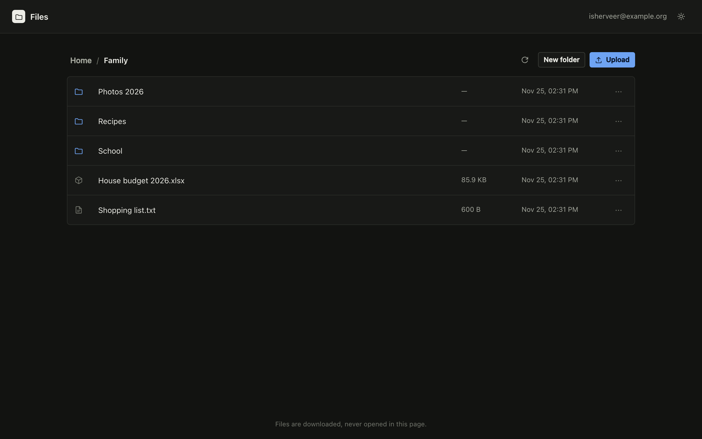
</picture>

<picture>
  <source media="(prefers-color-scheme: light)" srcset="docs/screenshots/portal-home-light.png">
  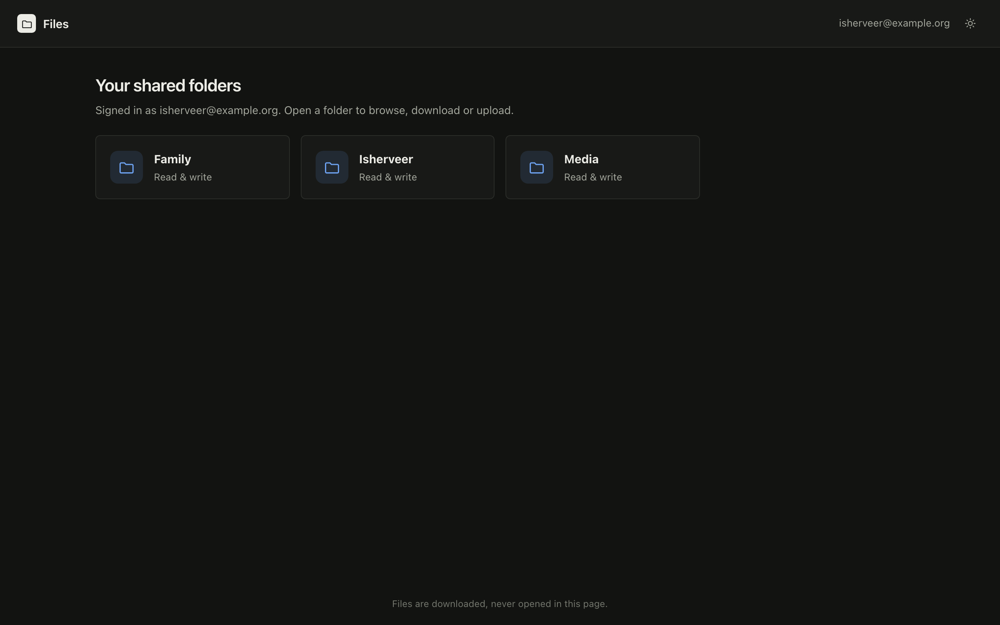
</picture>

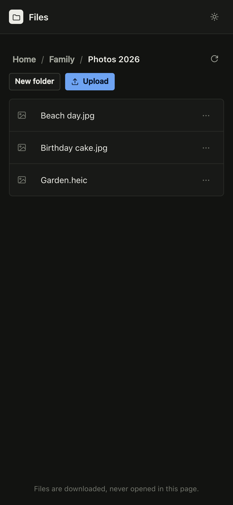

It uses the same rules as WebDAV: only the shares in the exposed list (PORTAL_EXPOSED_SHARES,
by default the same as DAV_EXPOSED_SHARES), only to users with Remote access ticked, with
exactly their read-only or read & write access, re-checked on every request. On top of that
it never overwrites anything (an upload with an existing name becomes "name (1).ext"), files
are always downloaded and never opened in the page, and shared folders can't be deleted or
renamed from it.

How a request travels:

```
browser --HTTPS--> Cloudflare --tunnel--> cloudflared --> Traefik/Pangolin (SSO) --HTTP--> smb-portal :8096
                                                          adds Remote-Email and X-Portal-Proxy-Secret
```

The portal knows who you are only from the Remote-Email header that Pangolin adds after you
sign in. A header is only as trustworthy as whoever set it, so the portal believes it only
when all of these hold, and refuses the request otherwise:

- the connection comes from an address in PORTAL_TRUSTED_PROXIES,
- it carries PORTAL_PROXY_SECRET in X-Portal-Proxy-Secret (a custom header you set on the
  Pangolin resource; without it, any other container on Traefik's network could pose as
  Pangolin),
- it came in over HTTPS, and there is exactly one Remote-Email holding one address,
- that address is linked to a user in the admin UI, and that user has Remote access.

Until you have proved on your own setup that Pangolin can't be tricked into passing a forged
Remote-Email (step 5), the portal runs in setup mode and serves no files at all.

### Setting it up

1. .env (the shares are the ones you already expose over WebDAV unless you set
   PORTAL_EXPOSED_SHARES):

   ```
   COMPOSE_PROFILES=dav,portal
   PORTAL_HOSTS=files.example.org
   PORTAL_TRUSTED_PROXIES=192.168.0.0/18
   PORTAL_PROXY_SECRET=<output of: openssl rand -hex 32>
   PORTAL_HEADER_VERIFIED=false
   ```

2. Add the same share-folder lines you gave smb-dav to smb-portal in docker-compose.yml:

   ```yaml
     smb-portal:
       volumes:
         - dav-bridge:/run/ssm-dav:ro
         - /mnt/files/Family:/mnt/files/Family
   ```

3. In the admin UI, Users, edit each person: put the e-mail they sign in to Pangolin with in
   **Sign-in e-mail (files portal)** and tick **Remote access**. One address per user.

4. In Pangolin, add a resource for files.<your domain> pointing at
   http://<server LAN IP>:8096. Leave Pangolin's authentication **on** (SSO with your
   identity provider; Pangolin forwards Remote-Email only for SSO-protected resources).
   Under the resource's custom headers, add `X-Portal-Proxy-Secret` with the value of
   PORTAL_PROXY_SECRET.

5. Start it (setup mode), sign in at https://files.example.org in a browser, and run the
   spoof test from any computer. It needs the browser's Cookie header for the portal
   (DevTools, Network, any request, Request Headers, cookie); it reads it without echo.

   ```bash
   docker compose up -d
   scripts/portal-spoof-test.sh https://files.example.org
   ```

   Only if it ends with "RESULT: safe", set `PORTAL_HEADER_VERIFIED=true` in .env and run
   `docker compose up -d` again. Run the test again after any Pangolin or Traefik upgrade.

Optional settings (.env): PORTAL_PORT and PORTAL_BIND_ADDR, PORTAL_MAX_UPLOAD_MB (default
DAV_MAX_UPLOAD_MB), PORTAL_IDENTITY_HEADER (default remote-email), PORTAL_UID (default
2998; must differ from PUID and DAV_UID).

### Troubleshooting

- "setup mode": PORTAL_HEADER_VERIFIED is still false (step 5).
- Plain "Forbidden": the request didn't come from PORTAL_TRUSTED_PROXIES or didn't carry the
  right X-Portal-Proxy-Secret. `docker logs smb-portal` shows `portal_refused` with the
  reason and the proxy's address.
- "not linked to a file account": the e-mail Pangolin sent isn't set on any user, or two
  users have it.
- A share is missing: same reasons as for WebDAV (not exposed, not mounted into
  smb-portal, no membership).
- Uploads over 100 MB fail from outside: Cloudflare's free plan limit, as with WebDAV.


Updating and rolling back
-------------------------

See docs/UPDATING.md. In short:

- Images are published to ghcr.io/codemastervy/smb-share-manager with the tags latest,
  YYYYMMDD and sha-<commit>.
- To pin or roll back, replace :latest in docker-compose.yml with a dated tag and run
  docker compose up -d.


Development
-----------

```bash
uv sync
```

```bash
uv run ruff check . && uv run ruff format --check . && uv run mypy && uv run bandit -q -r src -c pyproject.toml && uv run pytest
```

The web UI:

```bash
cd frontend && npm ci --ignore-scripts && npm run build
```

`npm run dev` serves the UI with live reload and forwards /api to a container on
port 8095.

The integration tests (tests/integration) need Docker and run in CI against the built
image, on both an exFAT loop mount and ext4. They include a real-browser test (Chromium)
of the UI. See scripts/ci/integration.sh.
